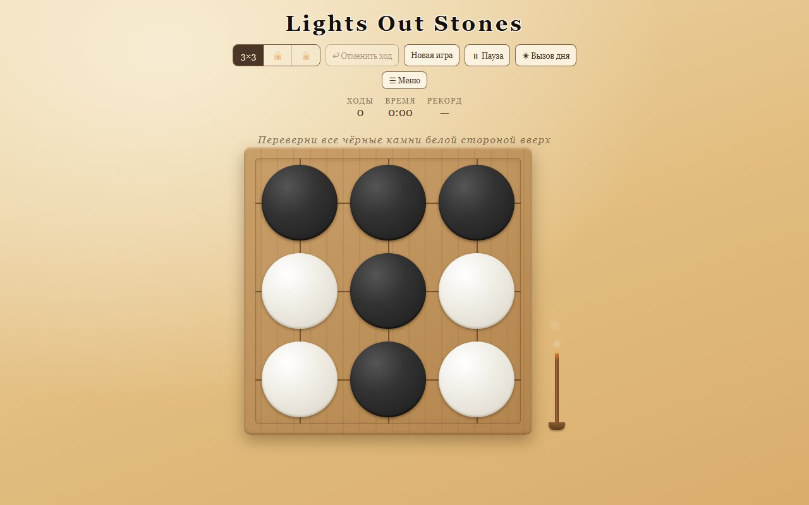

# Lights Out Stones

**Восточная головоломка с камнями, как в го.** Один HTML-файл, без сборки и зависимостей — работает в любом современном браузере, ставится на телефон как приложение (PWA) и играет офлайн.

[](https://jugaro.github.io/lights-out-stones/)



## Правила

На доске чёрные и белые камни. Нажатие на камень переворачивает его и все камни его строки и столбца (режим «Лучи») или его ближайших соседей по вертикали и горизонтали (режим «Крест»). Цель — привести всю доску к одному цвету: белому или чёрному, как выберешь.

## Возможности

- **Уровни 3×3 → 5×5 → 7×7** — открываются по очереди по мере побед
- **Два режима нажатия**: «Лучи» (строка + столбец) и «Крест» (соседи)
- **Три сложности**: от спокойной разминки до настоящей задачки
- **Вызов дня** — одна доска для всех игроков каждый день, с историей прохождений
- **Таймер, рекорды и список побед** — по уровням, режимам и сложностям
- **Автосохранение партии** — закрыл вкладку на середине игры, вернулся — продолжишь с того же места (с окна паузы)
- **Отмена хода, пауза, подсветка хода**, виброотклик на телефоне
- **Дзен-эстетика**: доска го, камни, тлеющая аромапалочка с дымком и потрескиванием, спокойная музыка
- **Победой можно поделиться** — с эмодзи-гридом стартовой доски, как в Wordle
- **PWA**: установка на главный экран, офлайн-режим через service worker

## Как играть

1. Открой [jugaro.github.io/lights-out-stones](https://jugaro.github.io/lights-out-stones/)
2. **На телефоне**: «Добавить на главный экран» — игра станет приложением со своей иконкой

## Технологии

- Один самодостаточный `index.html`: разметка, стили и логика, ноль зависимостей
- Звук переворота, тления и потрескивания — синтез через **Web Audio API**
- Фоновая музыка — зацикленный файл, кроссфейд без швов
- Деплой — **GitHub Pages** из ветки `main`
- Прогресс и настройки — `localStorage`, никаких серверов и аккаунтов

## Разработка

```bash
# тесты логики (node)
node tests/logic.test.mjs
```

Работа через feature-ветки → PR → squash-merge. История изменений — в коммитах и pull request'ах.

## Лицензия

[MIT](LICENSE)
